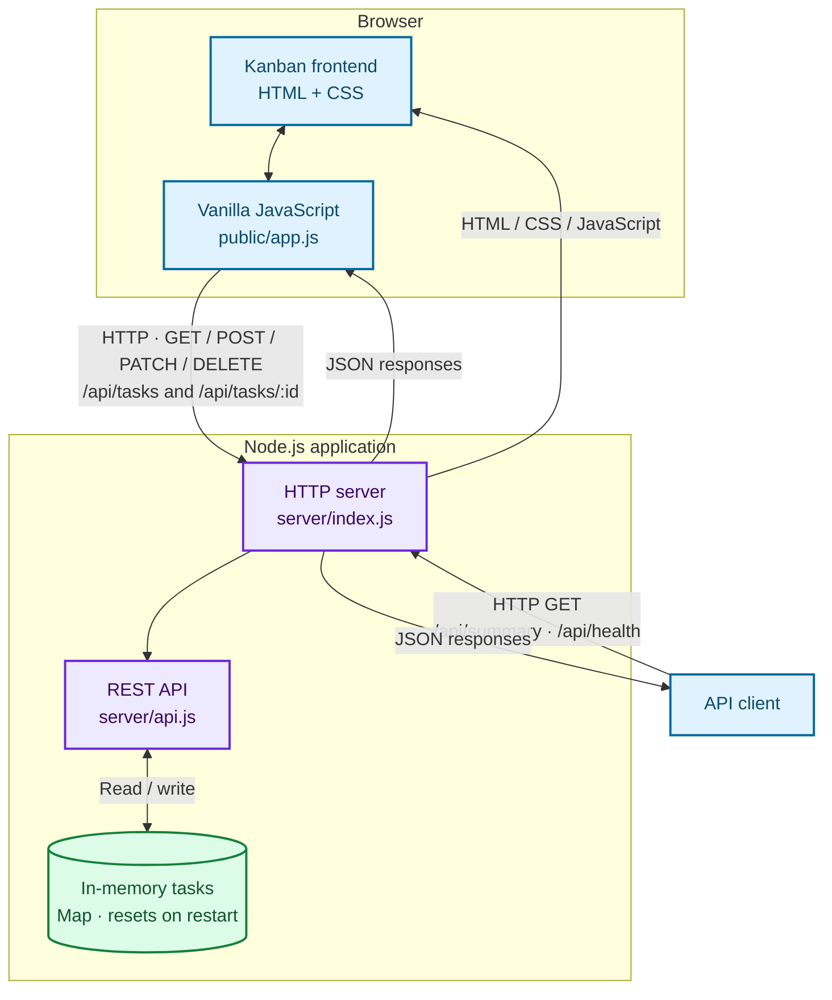
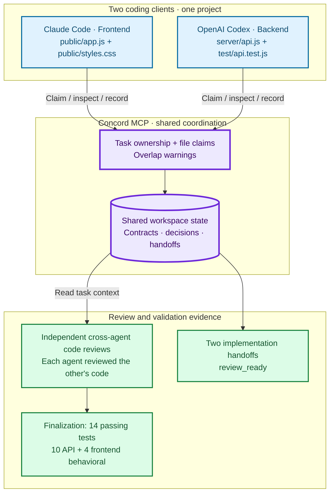

# Sprint Board — full-stack collaboration demo

A Kanban application prepared for an Entry-Level Full Stack Developer application, demonstrating a JavaScript frontend, a REST API, automated tests, and scoped Claude Code/Codex collaboration through Concord MCP.


## Installation and stack

Install Node.js 20 or later, clone or download this project, and run from its root:

```sh
npm start
```

Open http://127.0.0.1:3000. No npm installation is required: application and tests have no external dependencies. On Windows use `npm.cmd` if PowerShell blocks the npm shim. Stop with Ctrl+C.

The server reads `HOST` and `PORT` from the process environment (defaults: loopback and 3000). `.env.example` documents them; `.env` files are not automatically loaded.

- Frontend: HTML, CSS Grid/Flexbox, vanilla JavaScript and Fetch.
- Backend: Node.js HTTP server and in-memory task Map.
- Tests: built-in `node:test`, strict assertions, HTTP integration tests and `node:vm` frontend behavioral tests.
- Coordination: optional Concord MCP tooling, independent of the running application.

## Architecture and features

### Full-Stack Application Architecture



`server/index.js` starts the HTTP server and serves public assets through the handler in `server/api.js`.

Create tasks with title, description, owner and priority; move them between Backlog, In progress and Done; delete tasks; and search across title, description and owner. The labelled priority select combines with search using AND. Column counts reflect matching cards; sprint metrics remain unfiltered. The dashboard computes metrics from `/api/tasks`, rather than calling `/api/summary`.

| Method | Endpoint | Behavior |
| --- | --- | --- |
| GET | `/api/health` | Service health |
| GET | `/api/tasks` | Current task collection |
| POST | `/api/tasks` | Create task; defaults to medium priority and backlog |
| PATCH | `/api/tasks/:id` | Change status with current version; stale writes return 409 |
| DELETE | `/api/tasks/:id` | Remove task |
| GET | `/api/summary` | Counts recomputed from the complete current collection |

Fresh seed summary:

```json
{ "total": 5, "backlog": 2, "progress": 2, "done": 1 }
```

Counts change after mutations. Other summary methods return 405 with `Allow: GET`. Inputs are validated, JSON bodies are bounded, static serving is restricted, and task text uses `textContent`.

## Concord MCP integration

### Concord MCP Multi-Agent Collaboration Architecture

**The coordination layer is the focus of this demonstration: both agents used shared Concord task state, with separate implementation scopes.**



Arrows show shared-state workflow, not direct agent messaging or automated review/test orchestration by Concord. Direct agent-to-agent messaging was not tested. Tests were run by the agents; the 14-test result includes the later finalization phase.

Concord records file claims, overlap warnings, decisions and evidence-bearing handoffs through five workflow tools: `start_work`, `inspect_work`, `update_work`, `transfer_work`, and `finish_work`. Enforcement depends on client configuration.

| Agent | Responsibilities | Files |
| --- | --- | --- |
| Claude Code | Priority filter, search combination, responsive control styling | `public/app.js`, `public/styles.css` |
| Codex | Summary API and integration tests | `server/api.js`, `test/api.test.js` |
| Codex finalization | Test isolation, frontend tests, README and publication exclusions | `test/`, `README.md`, `.gitignore` |

Codex deliberately attempted to claim `public/app.js`; Concord detected overlap with Claude Code's frontend claim before any conflicting edit. The probe was closed and backend work registered separately. Both implementation tasks reached `review_ready`; finalization leaves their task records unchanged.

Each agent independently reviewed the other's implementation and reported PASS with low-severity recommendations. Finalization addresses shared API-test state and adds frontend behavioral coverage. [Historical evidence](docs/EVIDENCE.md) describes the earlier 10-test snapshot; its unresolved-finding descriptions are historical, not the current test status.

**Direct agent-to-agent messaging was not tested.** Live endpoints were unreachable; coordination used shared task state and handoffs. Codex identity was explicitly configured locally. Workspace IDs and databases are excluded because they can reveal absolute paths.

## Validation and evidence boundaries

```sh
npm run check
npm test
```

Windows equivalents: `npm.cmd run check` and `npm.cmd test`.

Historical progression: the Linux baseline passed 7 tests; the executed Windows multi-agent implementation and reviews passed 10 tests. The Windows setup script was executed for that experiment. See [historical and final evidence](docs/EVIDENCE.md).

Finalization on 8 November 2026: syntax check passed; **14 tests passed, 0 failed**: 10 API integration tests and 4 frontend behavioral tests. No dependencies were added. The Linux baseline records Node.js v22.16.0; the retained evidence does not establish the Node.js version for the Windows experiment or finalization. A later documentation-review check reported v26.13.0, which is not evidence of the earlier runtime.

| Evidence | Scope |
| --- | --- |
| Automated API verification | Health, empty list, CRUD, conflicts, invalid inputs/JSON, size limit, static serving/source blocking, empty summary, mutation/count consistency and POST rejection |
| Automated frontend verification | Priority options, combined search, case/whitespace handling, independent resets, empty states, column counts, unfiltered metrics, text rendering and retained search control |
| Isolation | Each API test starts and closes a fresh server with an empty collection |
| Manual browser validation, reported by the author | Priority filter, search, combined filters and summary consistency with the board; see historical evidence |
| Static cross-agent review | Native select label, focus styling, wrapping CSS and API compatibility |
| Not yet validated | Automated real-browser rendering, native keyboard/focus behavior, assistive technology, browser/device matrix, load testing, live messaging and production deployment |

Frontend tests execute the shipped script with a minimal DOM substitute. They do not simulate browser layout or prove accessibility. Manual browser results are author-reported; finalization does not claim a new browser run.

## Reproduce the demonstration

The app works without agent tools. For the optional Windows experiment:

1. Read [the configuration audit](docs/CONFIG-AUDIT.md) and review `scripts/setup-concord-sandbox.ps1` in a fresh copy. It pins Concord 0.20.0; authenticated agent CLIs are separate prerequisites.
2. Run `./scripts/setup-concord-sandbox.ps1` in PowerShell. It installs project-local tooling, avoids global adapter installation and refuses to overwrite existing MCP configs.
3. Start Claude Code from the project root and Codex via `./scripts/run-codex-sandbox.ps1`. Generated configurations use paths for your checkout; personal configs are not shipped.
4. Follow [the detailed protocol](docs/MULTI-AGENT-TEST.md): declare frontend ownership, attempt the overlapping claim before editing, inspect the warning, close/release the probe and claim backend files. Use fresh task IDs for a new experiment; preserve existing review-ready tasks.
5. Record the response contract with `update_work`, implement within claimed scopes, run checks, and submit `finish_work` review-ready handoffs. Do not attempt messages while endpoints are unreachable.
6. Perform independent read-only reviews and manual browser checks. Record actual outcomes rather than assuming historical results will repeat.

Optional setup requires network access. `npm start` and `npm test` install nothing. Detailed prompts and historical outputs are in `docs/`.

## Publication hygiene and limitations

`.gitignore` excludes local MCP registrations, agent settings, sandbox tools/homes, Concord state, credential/key files, environment secrets, logs, backups and temporary files. Portable scripts, generic instructions and `.env.example` remain shareable. Never force-add local exclusions. Ignore rules do not remove already tracked files or history: review the staged file list before a future commit.

This is a local demo: data resets on restart, authentication and persistence are absent, and the default binding is loopback. Custom `initialTasks` with unsupported statuses count toward summary `total` but no supported bucket. Unsupported summary methods are implemented generically; tests currently exercise POST. Do not store personal, confidential or employer data here.

The finalization phase performed no commits or publication; the repository was published afterward. The subsequent documentation consistency corrections are committed separately. The package declares MIT licensing.
